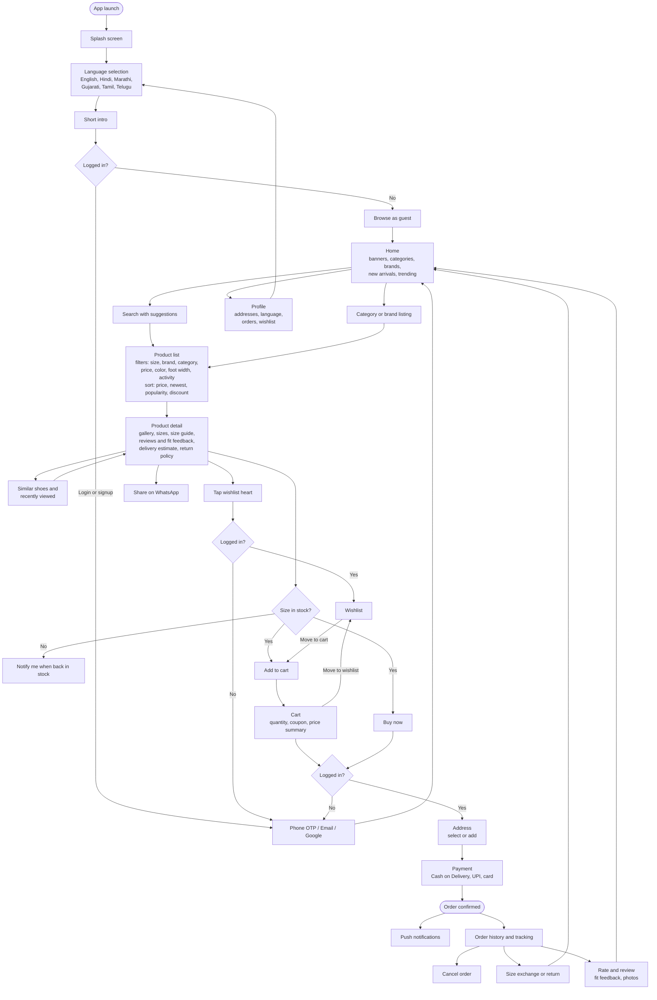

# ShoeAdda – Feature List (proposed)

Android shoe e-commerce app. Based on research of Myntra, Nike, Adidas, Flipkart, Foot Locker, Baymard footwear UX research and 2026 e-commerce app guides.

## Project constraints
There is no custom backend. This changes how some features work:

| Area | Approach |
|---|---|
| Products | Fetched from a free public API (to be chosen). Fields the API lacks, such as sizes, stock and foot width, are filled in locally |
| Login and OTP | Mock. Any OTP or a fixed code is accepted, no SMS is sent |
| User data | Stored on the device in Room (local DB): profile, addresses, cart, wishlist, orders, reviews, recent searches, language |
| Payments | Mock checkout. Cash on Delivery, UPI and card screens succeed without a real transaction |
| Orders and tracking | Saved locally. Tracking status is simulated over time |
| Reviews | Seeded sample reviews plus reviews the user writes, saved locally |
| Coupons | A small fixed list of codes stored in the app |
| Notifications | Local notifications only (order updates, back-in-stock simulated) |
| Data scope | Data lives only on one device. Uninstalling the app clears it, and there is no sync across devices |

## Design decisions
| Topic | Decision |
|---|---|
| Currency | ₹ INR. DummyJSON USD prices are converted once with a fixed rate (for example 1 USD = 85 ₹) and rounded to clean prices like ₹4,999 |
| Languages | Only the app UI is translated into the 6 languages. Product names and descriptions stay in English |
| Navigation | Bottom tabs: Home, Categories, Wishlist, Cart, Profile. Search bar sits at the top of Home. Language switch lives in Profile |
| Style | Clean and minimal: white space, one accent color, product photos lead |
| Edge states to design | Empty (cart, wishlist, orders, no search results), loading (skeleton placeholders), stock (out-of-stock size, low stock warning, sold out with Notify me). Error states (no internet, failed payment) are not designed in this round |
| Color theme | Option F, Cocoa and Mist (from the Octet mobile shopping palette). Light: background `#FBFBFB`, surface `#EEEEEC`, text `#131212`, accent `#68513F`, photo backdrop `#9BB3BE`, highlight `#A5967C`, border `#D4D5D2`, sale `#B4472F`, muted text `#6B6B66`. Dark: background `#131212`, surface `#1F1E1E`, text `#F2F0EC`, accent `#C9B79A`, photo backdrop `#2B3A41`, sale `#E58A72`. Tan and mist blue are for backgrounds and decoration only, never text |
| Typography | Nike-style pairing: Barlow Condensed (bold, uppercase for English headlines) + Archivo (body, UI, prices) + Noto Sans script fonts (Devanagari for Hindi and Marathi, Gujarati, Tamil, Telugu). Scale: display 36, title 22, body 15, caption 12, price 20 (sp on Android). Uppercase is applied to English text only. All fonts are free on Google Fonts and get bundled in the app |
| Intro | 2 slides after language selection, skippable |
| Wishlist access | Login required. A guest who taps a heart or the Wishlist tab is sent to login (no guest wishlist screen). After login the shoe is saved. Guests can only explore, search and add to cart |
| Material 3 (M3) | The Phase 1 designs do NOT strictly follow M3: custom icons (not Material Symbols), custom components, 44px touch targets, a 72px bottom bar with a top-line indicator, a custom type scale and mixed corner radii. During development (Phase 2) we will use strict M3 (Jetpack Compose Material 3 components, Material Symbols, 48dp touch targets, M3 navigation bar, type scale and 12/16/28dp shapes), themed with the Cocoa and Mist colors and the Barlow Condensed and Archivo fonts. Where the designs and M3 differ, M3 wins |
| Design status | Phase 1 screens done in light and dark mode, with a clickable prototype: https://claude.ai/artifact/TnBA85baHBMTnUDp41KRNd |
| Splash tagline | "Walk your way" for now, to be changed later |
| Mock OTP | Fixed OTP 123456, shown as a hint on the OTP screen |
| Mock payment | Always succeeds after a 2 second processing screen |
| WhatsApp share | Text plus product image, no link. Text has product name, brand, price in ₹, discount, and ends with the app name |
| Order tracking | Status advances on a short timer: Placed, Packed, Shipped, Out for delivery, Delivered |
| Coupons | WELCOME10 (10% off), SHOE200 (₹200 off over ₹1999), FREESHIP (free delivery) |

## Product data and filtering

### Product source
Products come from the free [DummyJSON](https://dummyjson.com) API (no key needed). It has two shoe categories, `mens-shoes` and `womens-shoes`, with 5 products each. Each product includes title, brand, price, discount, rating, stock, tags, images and sample reviews.

- Endpoints: `GET /products/category/mens-shoes` and `GET /products/category/womens-shoes`
- DummyJSON has only 10 shoes. To show filters, brands and sorting properly, we add 30 to 50 more shoes in a local JSON file bundled in the app (decided).

### Where each filter gets its data
| Filter / sort | Source | How |
|---|---|---|
| Category (Men, Women) | DummyJSON `category` field | From the API |
| Category (Sports, Casual, Formal) | Local | Mapped from DummyJSON `tags` or assigned in the local JSON. The Kids category is dropped in version 1 (no free kids' shoe photos found) |
| Brand | DummyJSON `brand` field | From the API. The brand row on Home is the list of distinct brands |
| Price range | DummyJSON `price` | Filtered locally |
| Sort by price, discount, rating, newest | DummyJSON `price`, `discountPercentage`, `rating`, `meta.createdAt` | Sorted locally |
| Sort by popularity | DummyJSON `rating` | Used as a stand-in for popularity |
| Search | DummyJSON `title`, `brand`, `tags` | Searched locally in Room (the API also has `/products/search?q=`) |
| Size | Local | See below |
| Color | Local | Set per shoe in the local data |
| Foot width, activity type | Local | Set per shoe in the local data |

### Sizes and foot size
DummyJSON has no sizes, so sizes are added locally.

1. **Size list:** each shoe gets a size list by category. Men: UK 6 to 11. Women: UK 3 to 8. (Kids is dropped in version 1.)
2. **Size chart:** one local table converts UK, US, EU and foot length in cm, so the user can switch between systems.
3. **Stock per size:** DummyJSON gives one `stock` number per shoe. We split it across sizes. Sizes with 0 are greyed out and enable the Notify me button.
4. **Foot size helper:** the size guide takes the user's foot length in cm and suggests the nearest size from the chart. The suggestion can be saved in the profile and pre-selected on product pages.
5. **Size filter:** shows shoes that have the chosen size in stock.

### How filtering works in the app
1. On first launch, the app fetches the shoes from DummyJSON, merges them with the local extras, and saves them in Room.
2. All filters, sorting and search run as Room queries on that local data, so they are instant and work offline.
3. Filter choices (size, brand, price, color, width, activity) combine with AND between filter types and OR within one type, for example Nike or Puma, AND UK 9, AND under 100.
4. The app refreshes from the API occasionally and keeps cart, wishlist and orders untouched.

## 1. Must-have (Version 1)

### Onboarding and account
- Splash screen and short intro
- Language selection page on first launch (English, Hindi, Marathi, Gujarati, Tamil, Telugu), changeable later in Profile
- Login / Signup (phone OTP, email, Google)
- Profile, saved addresses
- Guest browsing. Login is required at checkout and to save items to the wishlist

### Browse and discover
- Home: banners, categories (Men, Women, Sports, Casual, Formal), brand row, new arrivals, trending
- Product listing grid with infinite scroll
- Search with suggestions and recent searches

### Filter and sort
- Filters: size, brand, category, price range, color
- Sort: price low to high, high to low, newest, popularity, discount

### Product detail page
- Image gallery with zoom
- Size selector, out-of-stock sizes greyed out
- Price, discount, delivery estimate
- Description, material, specifications
- Add to cart, Buy now, Wishlist heart
- WhatsApp share
- Return and exchange policy summary

### Cart and wishlist
- Cart with quantity change, remove, move to wishlist
- Price summary (subtotal, discount, delivery, total)
- Wishlist with move to cart

### Checkout and orders
- Address selection and add address
- Payment options (Cash on Delivery, UPI, cards)
- Order confirmation
- Order history, order tracking, cancel order

### Sharing
- Share a shoe on WhatsApp (name, image, price, link)

## 2. Shoe-specific features (reduce returns)
- Size guide with foot-length converter (UK, US, EU, cm)
- Fit feedback in reviews (runs small, true to size, runs large)
- Size accuracy and comfort ratings on product cards
- Fit filters: foot width, activity type (running, walking, formal)
- Easy size exchange instead of refund only
- Photo reviews

## 3. Should-have (Version 1.x)
- Coupons and offers, sale banners
- Notify me when back in stock
- Recently viewed and "similar shoes" rows
- Push notifications (order updates, offers)
- Ratings and reviews with verified-buyer badge

## 4. Later (Version 2)
- Biometric login and saved payments (one-tap checkout)
- Personalized recommendations
- Brand drop and launch alerts
- AR virtual try-on
- Visual search
- Loyalty points and referral rewards

## Open questions
- Final list of the 30 to 50 extra shoes in the local JSON file (brands, categories, sizes, images)
- Payment screens to include in the mock checkout
- Which Version 1.x items move into Version 1

## Phase 2 decisions (proposed, see `TECH_STACK.md`)
- Kotlin, Jetpack Compose with strict Material 3, MVVM with unidirectional data flow (Google's recommended architecture), Room 2.x, Preferences DataStore, Retrofit for DummyJSON, Coil 3, Coroutines and Flow.
- Not used: RIBs, server-driven UI (too heavy for a small app with no backend), Room 3 (still release candidate).
- Confirmed: minimum Android 8.0 (API 26), Hilt, Navigation 3, no Firebase in v1, phone first (no tablet layouts in v1).

## 5. User journey

### Step by step
1. **Launch:** splash screen, then language selection (6 languages), then a short intro.
2. **Entry:** browse as a guest, or log in or sign up with phone OTP, email or Google.
3. **Discover:** the home screen shows banners, categories, brands, new arrivals and trending shoes. The user can also search with suggestions.
4. **Narrow down:** the product list can be filtered by size, brand, category, price, color, foot width and activity, and sorted by price, newest, popularity or discount.
5. **Evaluate:** on the product page the user checks images, size availability, size guide, fit feedback and reviews, delivery estimate and the return policy. Recently viewed and similar shoes sit below.
6. **Act:** the user can wishlist the shoe (login required), share it on WhatsApp, turn on a back-in-stock alert for a sold-out size, add it to the cart, or tap Buy now.
7. **Cart:** change quantity, move items to the wishlist, apply a coupon and check the price summary.
8. **Checkout:** log in if still a guest, choose or add an address, pick a payment method (Cash on Delivery, UPI, card) and place the order.
9. **After purchase:** order confirmation, push notifications for order updates, order tracking, cancel order, request a size exchange or return.
10. **Come back:** the user rates and reviews the shoe with fit feedback and photos, then returns to browsing from the home screen.

### Journey diagram

