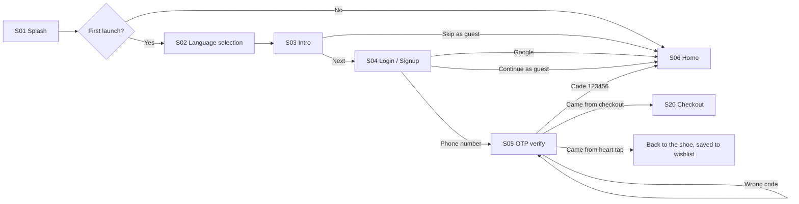
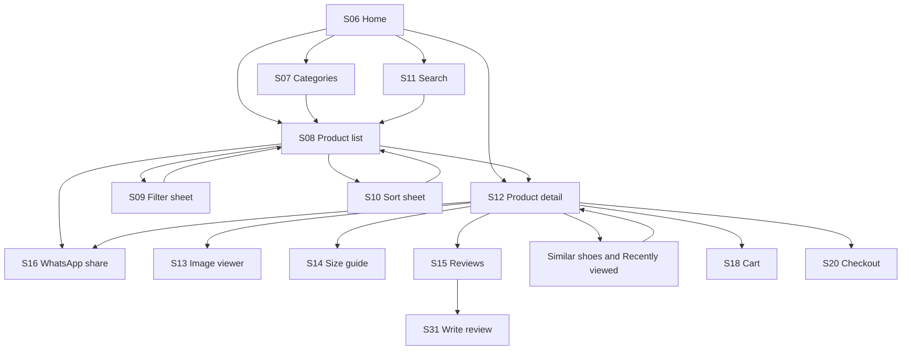
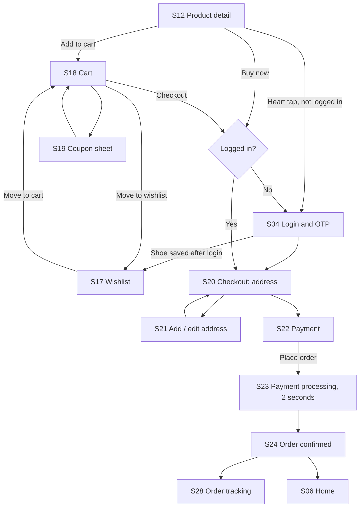
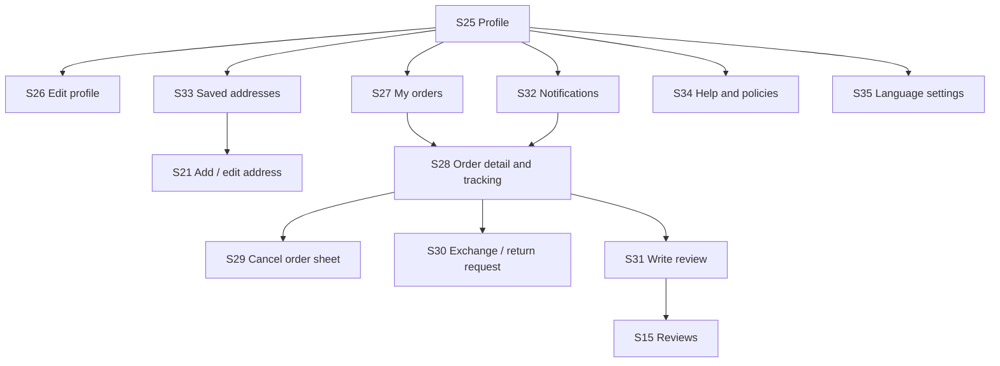
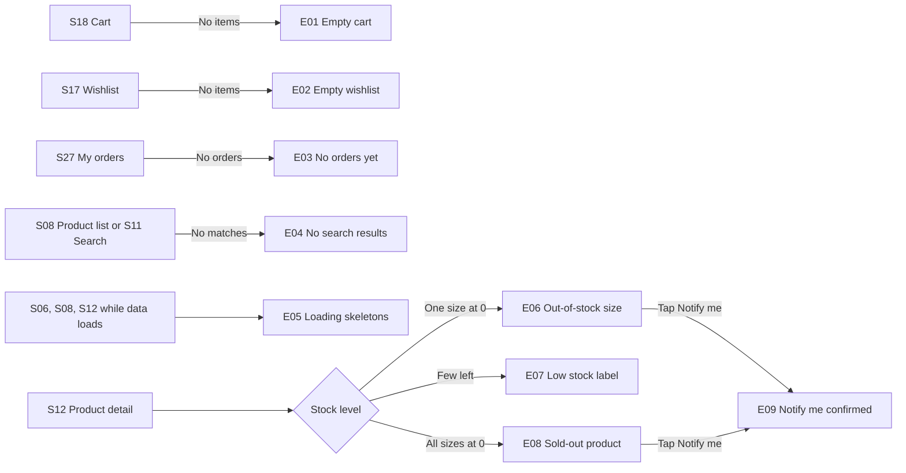

# ShoeAdda – Screen Inventory

Every screen in the app, what it shows, where the user comes from and where they go next. Built from `FEATURES.md` (features, user journey, design decisions).

**Global rules for all screens**
- Prices in ₹. Only the app UI is translated (English, Hindi, Marathi, Gujarati, Tamil, Telugu). Product names stay in English.
- Colors: Cocoa and Mist (light and dark mode). Fonts: Barlow Condensed (headlines), Archivo (body), Noto Sans scripts for Indian languages.
- Bottom tabs on main screens: Home, Categories, Wishlist, Cart, Profile. Hidden on checkout and detail screens.
- Guests can browse. Login is required at checkout and to save to the wishlist. When a guest taps a heart, the login screen opens, then returns to the same shoe and saves it.
- **Material 3:** these screens are a visual guide only and do not strictly follow M3 (custom icons and components, 44px touch targets, custom type scale and radii). Development will use strict M3 (Compose Material 3, Material Symbols, 48dp targets, M3 nav bar), themed with our colors and fonts. If a screen differs from M3, build it the M3 way.
- Mock login OTP is 123456. Payment always succeeds after a 2 second processing screen.

## Summary
| Group | Screens |
|---|---|
| A. Start | 5 |
| B. Shop | 11 |
| C. Cart and buy | 8 |
| D. Account and orders | 11 |
| E. Edge states | 9 |
| Shared components | 7 |
| **Total** | **44 screens and states, plus 7 shared components** |

---

## A. Start

| ID | Screen | What it shows | Comes from | Goes to |
|---|---|---|---|---|
| S01 | Splash | Logo and tagline for about 2 seconds | App launch | S02 on first launch, otherwise S06 |
| S02 | Language selection | Six language cards (English, Hindi, Marathi, Gujarati, Tamil, Telugu) each shown in its own script, a Continue button. Also reachable from Profile | S01, S25 | S03 on first launch, back to Profile otherwise |
| S03 | Intro | Two swipe slides: (1) browse, filter and size help to find your fit, (2) easy checkout, order tracking and size exchange. Skip and Next buttons | S02 | S04 or S06 (Skip as guest) |
| S04 | Login / Signup | Phone number field, Continue with Google, Continue as guest. Terms text | S03, S18 or S20 (when a guest checks out), or any heart tap by a guest (S06, S08, S12, S17) | S05, or back to where the user came from |
| S05 | OTP verify | Six-digit code boxes, hint showing the mock code 123456, resend timer, wrong-code error message | S04 | S06, or back to checkout |

## B. Shop

| ID | Screen | What it shows | Comes from | Goes to |
|---|---|---|---|---|
| S06 | Home | Top bar (logo, search field, cart badge), banner carousel, category chips (Men, Women, Kids, Sports, Casual, Formal), brand row, New arrivals, Trending, Recently viewed row | S01, S05, tabs | S08, S11, S13 |
| S07 | Categories | Category tiles with images, brand list, tapping opens the product list pre-filtered | Tab | S08 |
| S08 | Product list | Grid of shoe cards (image, brand, name, price, discount, rating, wishlist heart), filter and sort buttons with active-filter count, result count | S06, S07, S11 | S09, S10, S13 |
| S09 | Filter sheet | Size (UK, US, EU toggle), brand, category, price range slider, color, foot width, activity type, Reset and Apply with result count | S08 | S08 |
| S10 | Sort sheet | Price low to high, price high to low, newest, popularity, discount | S08 | S08 |
| S11 | Search | Search field, recent searches, suggestions as the user types, trending searches | S06 top bar | S08 (results) |
| S12 | Product detail | Image gallery with dots and zoom, wishlist heart, share button, brand, name, rating, price with strikethrough and discount, size selector with greyed out sizes and a low-stock note, size guide link, delivery estimate, description and specs, fit feedback summary, top reviews, Similar shoes row, Recently viewed row, return policy summary. Sticky Add to cart and Buy now buttons | S06, S08, S17, S18 | S13, S14, S15, S18, S20 |
| S13 | Image viewer | Full-screen pinch to zoom, swipe between images | S12 | S12 |
| S14 | Size guide | Chart converting foot length (cm) to UK, US, EU. Foot length input that suggests the nearest size and a Save to profile option. How to measure illustration | S12 | S12 |
| S15 | Reviews | Overall rating, bar chart by star, fit feedback bars (runs small, true to size, runs large), comfort rating, review list with photos and verified buyer badge, Write a review button | S12 | S31 |
| S16 | WhatsApp share | Android share sheet opens WhatsApp with the product image and a message: brand, name, price in ₹, discount, app name. No link | S12, S08 | Returns to the same screen |

## C. Cart and buy

| ID | Screen | What it shows | Comes from | Goes to |
|---|---|---|---|---|
| S17 | Wishlist | Grid of saved shoes with Move to cart, remove, and a Notify me tag on sold-out sizes. Guests never see this screen: the Wishlist tab opens Login (S04) for them | Tab | S12, S18 |
| S18 | Cart | Item rows (image, name, size, quantity stepper, price), remove and Move to wishlist, coupon field, price summary (subtotal, discount, delivery, total), Checkout button | Tab, S12 | S19, S20 (S04 first for guests) |
| S19 | Coupon sheet | List of the three coupons (WELCOME10, SHOE200, FREESHIP) with conditions, manual code field, Apply, error for invalid code | S18 | S18 |
| S20 | Checkout: address | Saved address list with a selected card, Add new address button, delivery estimate, order summary | S18, S12 (Buy now) | S21, S22 |
| S21 | Add / edit address | Name, phone, pincode, house, area, city, state, address type (Home, Work), Set as default | S20, S33 | S20, S33 |
| S22 | Payment | Options: Cash on Delivery, UPI, Card, with their fields. Order summary, Place order button | S20 | S23 |
| S23 | Payment processing | Two second animated screen: "Processing your order" | S22 | S24 |
| S24 | Order confirmed | Success animation, order number, delivery estimate, items summary, Track order and Continue shopping buttons. Triggers a local notification | S23 | S28, S06 |

## D. Account and orders

| ID | Screen | What it shows | Comes from | Goes to |
|---|---|---|---|---|
| S25 | Profile | Avatar, name, phone, shortcuts (Orders, Wishlist, Addresses, Notifications), Language, Saved foot size, Help and policies, Dark mode toggle, Log out. Guests see a Log in prompt | Tab | S26 to S35 |
| S26 | Edit profile | Name, phone, email, saved foot size | S25 | S25 |
| S27 | My orders | Order cards with status chip, date, item thumbnails, total. Filter chips (All, Active, Delivered, Cancelled) | S25, S24 | S28 |
| S28 | Order detail and tracking | Status timeline (Placed, Packed, Shipped, Out for delivery, Delivered) that advances on a timer, items, address, payment method, price breakdown, Cancel order, Exchange or return, Rate this shoe | S27, S24 | S29, S30, S31 |
| S29 | Cancel order sheet | Reason list, Confirm cancel | S28 | S28 |
| S30 | Exchange / return request | Choose item, reason, Size exchange (new size picker) or Return, confirm | S28 | S28 |
| S31 | Write review | Star rating, fit question (runs small, true to size, runs large), comfort rating, comment, add photos from gallery, Submit | S15, S28 | S15 |
| S32 | Notifications | List of local notifications: order updates, back in stock, offers, with unread dots | S25, top bar | S28, S12 |
| S33 | Saved addresses | Address cards, edit, delete, set default, Add new | S25 | S21 |
| S34 | Help and policies | Return and exchange policy, delivery info, FAQ, About ShoeAdda | S25, S12 | Back |
| S35 | Language settings | Same layout as S02, opened from Profile, applies immediately | S25 | S25 |

## E. Edge states

Designed this round: empty, loading, and stock states. Error states (no internet, failed payment) are not designed yet.

| ID | State | Where it appears | What it shows |
|---|---|---|---|
| E01 | Empty cart | S18 | Illustration, "Your cart is empty", Start shopping button |
| E02 | Empty wishlist | S17 | Illustration, short message, Browse shoes button |
| E03 | No orders yet | S27 | Illustration, message, Shop now button |
| E04 | No search results | S08, S11 | Message with the searched word, tips, popular categories |
| E05 | Loading skeletons | S06, S08, S12 | Grey placeholder blocks shaped like the final content |
| E06 | Out-of-stock size | S12 | Size chip greyed and struck through, tap shows "Notify me when available" |
| E07 | Low stock | S12, S18 | "Only 2 left" label in the sale color |
| E08 | Sold-out product | S12, S08 | Image dimmed with a "Sold out" badge, Add to cart replaced by Notify me |
| E09 | Notify me confirmed | S12 | Toast "We'll tell you when UK 8 is back" and the button changes to "Notification on" |

## Shared components

| Component | Used on |
|---|---|
| Bottom tab bar (Home, Categories, Wishlist, Cart with badge, Profile) | S06, S07, S17, S18, S25 |
| Top bar (logo or title, search, cart badge, back arrow) | Most screens |
| Product card | S06, S08, S17 |
| Bottom sheet (filter, sort, coupon, cancel) | S09, S10, S19, S29 |
| Size chip (default, selected, out of stock) | S12, S09, S30 |
| Buttons (primary cocoa, outlined, text) and toast messages | All |
| Rating stars and fit-feedback bar | S08, S12, S15, S31 |

## Design order (suggested batches)
1. **Batch 1, core shopping:** S06 Home, S08 Product list, S09 Filter sheet, S12 Product detail, S14 Size guide.
2. **Batch 2, cart and buy:** S18 Cart, S20 Checkout address, S22 Payment, S24 Order confirmed.
3. **Batch 3, start and account:** S01 to S05, S25 Profile, S27 Orders, S28 Order tracking.
4. **Batch 4, remaining screens and edge states:** everything else.

## Design status (Phase 1)
- All 44 screens are designed in light mode and dark mode (88 boards) on the Design canvas: https://claude.ai/artifact/TnBA85baHBMTnUDp41KRNd
- Light screens form a clickable prototype (Play mode): Splash, Language, Intro, Login, OTP, Home, Product list, Product detail, Cart, Checkout, Payment, Processing, Order confirmed, Order detail. Sheets, extras and edge screens are linked too.
- Dark screens are static (not linked).
- Not designed on purpose: error states (no internet, payment failed), tablet and landscape layouts.

## Decisions
- Intro (S03) has 2 slides.
- Guests cannot save to the wishlist. They must log in first. Tapping a heart or the Wishlist tab opens the login screen. There is no separate guest wishlist screen. Guests can explore, search and add to cart; login is needed at checkout.
- Splash tagline stays "Walk your way" for now and will be changed later.
